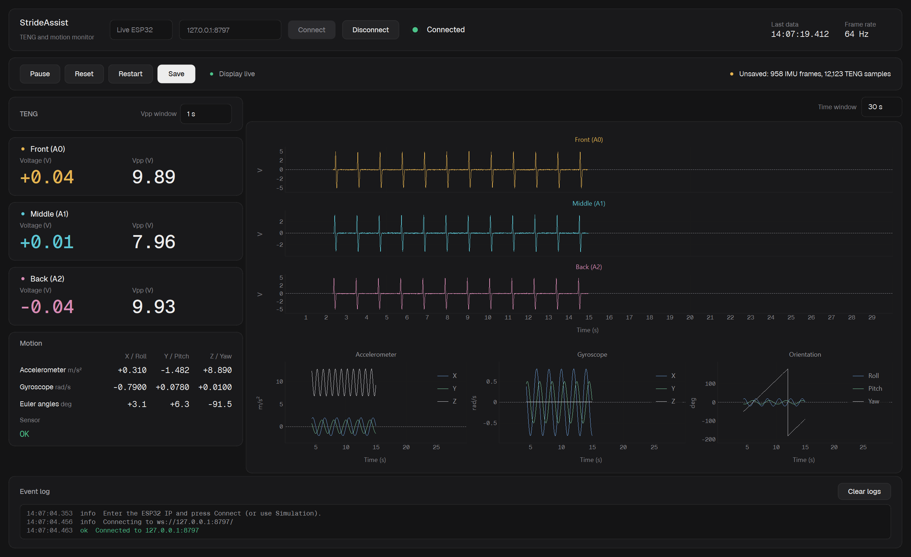

# Stride

Real-time desktop monitor for a smart-shoe sensor node: an **ESP32** streaming three **TENG** voltages
(Front A0, Middle A1, Back A2, read through an ADS1115) and **IMU** data over Wi-Fi.
Built with PySide6 and pyqtgraph, small and fast on purpose.



## What it shows

- **Header:** Connect, Disconnect, IP field, connection status, last data time, frame rate.
  **Pause** (display only, recording continues), **Reset**, **Restart**, **Save**, and an "Unsaved: N IMU frames, N TENG samples" counter.
- **Three TENG cards**, always "Front (A0)", "Middle (A1)", "Back (A2)", each with its own colour and exactly two numbers:
  the newest voltage and the peak-to-peak voltage (Vmax − Vmin) over one shared sliding window
  (100 ms, 500 ms, 1 s or 2 s; default 1 s). An asterisk follows Vpp when that channel clipped inside the window, and a red banner
  shows while its clip bit is set.
- **Charts:** three stacked TENG plots on a shared time axis (time window 1 to 30 s), then Accelerometer, Gyroscope and Orientation
  (roll, pitch, yaw) side by side.
- **Motion numbers:** accelerometer, gyroscope, Euler angles and the IMU status.
- **Event log:** 200 lines, connection events and errors only (never one line per message).
- **Simulation mode** (header dropdown): a built-in fake ESP32 speaks the same protocol, clearly marked as simulated and never mixed with live data.

## Install and run

Python 3.10+ (developed on 3.14, Windows 11).

```powershell
git clone https://github.com/jagrutgarg/stride
cd stride
python -m venv .venv
.venv\Scripts\python -m pip install -r requirements.txt
.venv\Scripts\python imu_teng_monitor\main.py
```

macOS / Linux: use `.venv/bin/python`. Try it without hardware by choosing **Simulation** and pressing Connect.
`orjson` is optional (faster JSON); without it the standard `json` module is used.

Tests (they use the simulator, no hardware needed):

```powershell
cd imu_teng_monitor
..\.venv\Scripts\python -m pytest tests -q
```

## Connect the ESP32

Enter the ESP32's IP in the header and press **Connect**. The GUI connects to `ws://<ip>:81/`. It sends nothing except the text
`zero` when you press **Reset**, which asks the ESP32 to re-zero the TENG baselines.

**Firmware:** the GUI reads the "version 2" message format below. The firmware is not part of this repository, and a firmware
that sends the older format (single `v` array, `ok`/`iok`/`cal`/`clip`, quaternion, gravity, ...) is **not** supported: those frames
are logged as invalid packets.

## Protocol (version 2)

First message after connecting (configuration, not a data frame): `{"info": {... "scales" ..., "range_V": ...}}`.
`range_V` is used in the clip banner text; the rest is stored in the Excel summary.

Then about 50 data frames per second, every value an integer:

```
{"t":ms, "s":status, "cp":us, "r":[roll,pitch,yaw], "a":[x,y,z], "g":[x,y,z], "f":[...], "m":[...], "b":[...]}
```

| field | meaning |
| --- | --- |
| `t` | ESP32 `millis()` of the newest sample |
| `cp` | sample period in microseconds |
| `r` | Euler angles, value / 100 = degrees |
| `a`, `g` | accelerometer value / 1000 = m/s², gyroscope value / 1000 = rad/s |
| `f`, `m`, `b` | TENG Front (A0), Middle (A1), Back (A2), value / 1000 = volts; all three the same length n |
| `s` | status bit mask: 1 ADS ok, 2 IMU ok, 4 calibrating, 8 / 16 / 32 front / middle / back clipped in this frame |

**Time axis:** sample k of an n-sample frame happened at `t − (n−1−k)·cp/1000` ms on the ESP32 clock. That is used for plots, Vpp and
exports; the frame arrival time is never used for sample times (it only labels the wall-clock start). A restart of the ESP32 clock
is detected and the axis continues instead of jumping back.

## Calibration: applied in one place

The firmware sends calibrated volts, so **the firmware's calibration is the one that applies**. `imu_teng_monitor/config/channels.py`
has a per-channel `scale` / `sign` block that is a pass-through and must stay at 1.0 / +1; it is applied in exactly one place
(`sensors/pipeline.py`). If it is changed the app logs an "applied twice" warning on every connection. The Excel summary records that
the volts are firmware-calibrated.

## Saving

**Excel:** `TENG Data` (Timestamp, Time (s), Channel, TENG Voltage (V), Measurement Validity, Display segment), `IMU Data`
(roll, pitch, yaw, accelerometer, gyroscope, IMU OK) and `Session Summary` (per-channel min / max / average, connection info,
the firmware info message). **CSV:** one row per TENG sample with the channel name, volts, validity and the latest IMU columns.
Export runs in a background thread, in chunks, so the UI never waits. Everything stays in memory until saved
(about 100 MB per hour); sheets continue on `... 2` past 1,000,000 rows.

## How it stays fast

- Receive, parse (orjson if installed, once per message), timestamps, calibration pass-through, ring buffers, the sliding Vpp window
  and recording all run in the receive thread. The UI thread only reads small snapshots under a short lock and draws.
- Preallocated numpy ring buffers per TENG channel and for the IMU. Vpp uses a monotonic deque: O(1) amortised per sample, using
  each sample's own timestamp.
- Charts redraw at about 25 fps and only when new data arrived (not while paused or minimised); numbers refresh at about 15 Hz.
  The visible window is min/max-decimated to at most 2 points per pixel (peaks survive); Y axes rescale at most 5 times per second;
  antialiasing is off; each Y axis uses a single tick level (pyqtgraph's default horizontal grid alone cost about 17 ms per repaint).
- Measured with three simulated channels in a 2559×1400 window: process CPU about 42 % of one core (the previous version of this
  app: 98.6 %), graph area draw about 13 ms per frame (previously 17.5 ms).

## Project layout

```
imu_teng_monitor/
  main.py                 entry point
  communication/          WebSocket client thread, version 2 parser
  sensors/                pipeline, ring buffer, sliding min/max, time axis
  storage/                in-memory session store, Excel / CSV export
  gui/                    main window, cards, charts, theme
  simulation/             fake ESP32 (version 2) for demos and tests
  config/                 channel config block, settings
  tests/                  pytest suite (parser, time axis, Vpp, pipeline, GUI against the simulator)
```

## Known limits

- Tested against the built-in simulator only; not validated on real hardware by this repository's tests.
- The ESP32 reaction to the `zero` command and the keys of the `info` message other than `range_V` are not verified.
- If the IMU is not detected (status bit 2 clear) the IMU values stay at zero and the GUI logs that once per connection.
- No license has been chosen for this repository yet.

## Credits

- UI direction follows the [unslop](https://github.com/heydamir/unslop) design guidance by Damir Sokolovsky (CC BY 4.0).
- Fonts: [Geist and Geist Mono](https://github.com/vercel/geist-font) (SIL Open Font License, see `imu_teng_monitor/assets/fonts/OFL.txt`).
